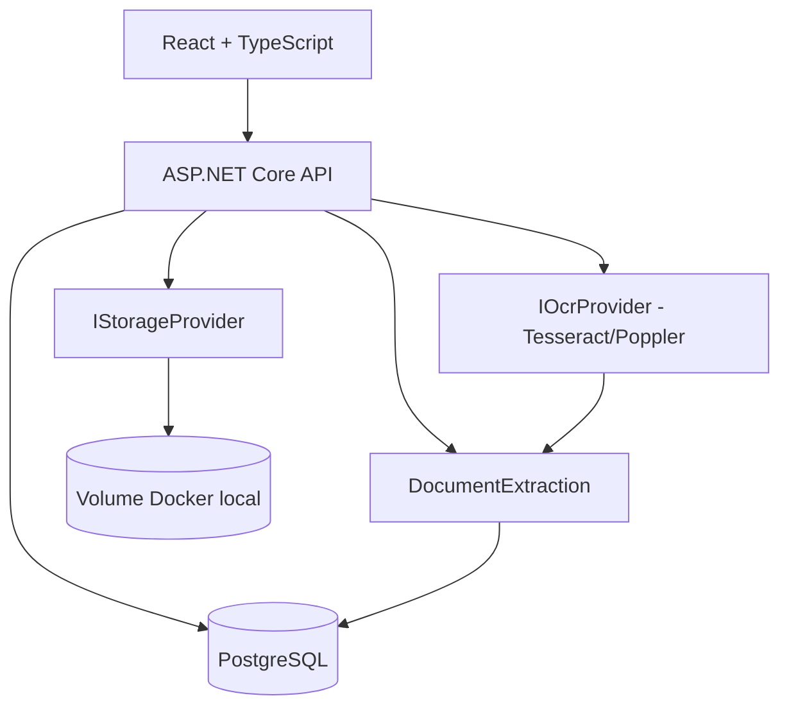

# Arquitetura inicial

## Fluxo 1 — primeiro documento

1. Upload por multipart (até 25 MiB), salva storage com chave UUID e SHA-256.
2. OCR do documento (imagens e PDF). Também há entrada TXT de teste.
3. Extrator sugere campos conhecidos por expressões regulares, sem alucinação de valores.
4. Operador seleciona campos, define nome, palavras-chave e salva `DocumentType`.
5. Operador aplica modelo, revisa valores e confirma a indexação.

## Fluxo 2 — próximo documento

1. Upload + OCR.
2. Motor avalia keywords dos modelos ativos do tenant.
3. Se houver melhor correspondência não ambígua, aplica o modelo automaticamente.
4. Valores são extraídos, ficam `NeedsReview` e aguardam confirmação (proteção inicial contra erros de OCR).

## Modelo físico

`PhysicalLocation` possui `ParentId`, `Kind` e `Name`; `PhysicalBox` possui `LocationId`. A rota é reconstruída da caixa até a raiz. Um documento possui `PhysicalBoxId`. Movimentações históricas são escopo posterior.

## Segurança e disponibilidade

Este MVP **não implementa autenticação**. `X-Tenant-Id` existe somente para testes; não confere isolamento seguro. O storage local e o PostgreSQL persistem em volumes nomeados de Docker. Não exponha as portas publicamente. Backups, auditoria, malware scanning e criptografia em repouso estão pendentes.
